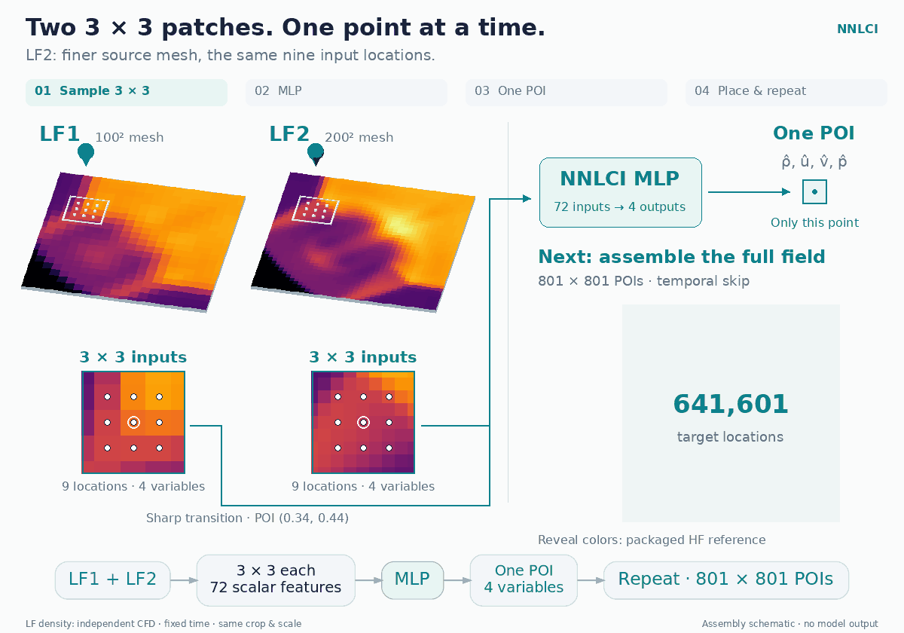
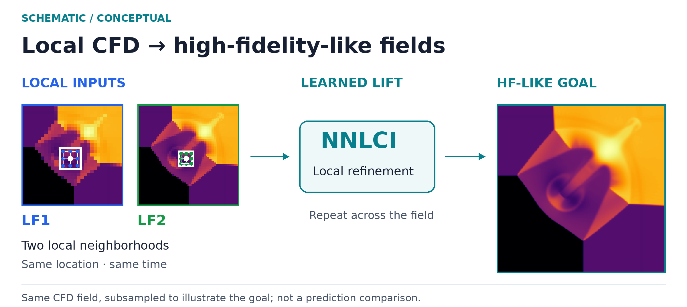
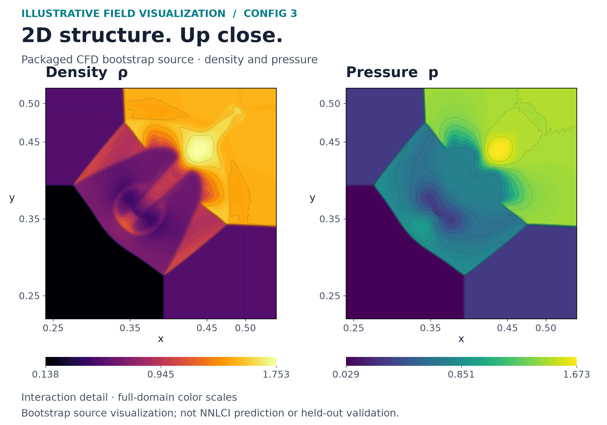
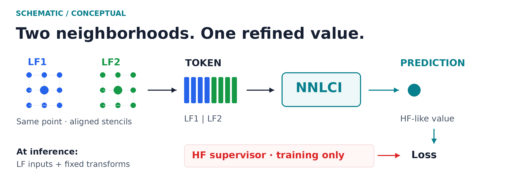
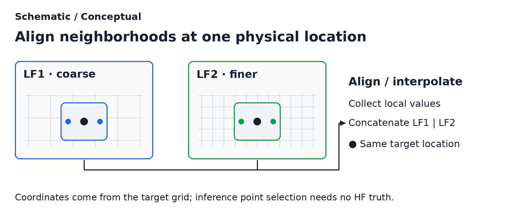

[Motion-free opening](docs/assets/promo/nnlci_motion_poster.png)



> **Evidence boundary.** Opening imagery is conceptual. Config 3 is a two-epoch bootstrap software check evaluated on training arrays; the contours below show its packaged CFD source, not held-out NNLCI accuracy. Sod below is packaged checkpoint evidence.



*Illustrative field visualization · Config 3 interaction detail.
[Full domain](docs/assets/promo/config3_full_domain.png) · [Source & rendering](docs/assets/promo/README.md#2d-fields-and-the-motion-open)*

# NNLCI: CFD-informed fidelity lift

Learn from local coarse-CFD neighborhoods to reconstruct high-fidelity-like fields.

## How it works



*Local inputs at the same physical time; HF supervises training.
[Alignment close-up](#local-alignment)*

## Results from this repository


*Checkpoint result · Sod P1.25 density: compare transition widths and wave positions.
[Gallery: overlay, arrays & provenance](docs/assets/promo/README.md)*

<details id="local-alignment">
<summary>Local alignment: a closer look</summary>



*Schematic / Conceptual · alignment precedes local feature collection; packaged Euler demos use structured grids.
[Full-size close-up](docs/assets/nnlci-local-stencil-explained.png)*

</details>

## Run a supplied checkpoint

After [installation](#installation) and LFS retrieval, run from the repository root:

```bash
python problems/1d_sod/src/prediction/predict.py
```

Uses supplied data and weights; writes `problems/1d_sod/results/predictions/` without training.
[Sod guide](problems/1d_sod/README.md) · [Four workflows](#choose-a-workflow) ·
[Package provenance](docs/UPLOAD_MANIFEST.md) · [Citation](#citation)

<details>
<summary>Input contract and deployment</summary>

LF1/LF2 neighborhoods share physical case, location, variables, and output time.
Locality and converging inputs provide refinement trends; the model architecture is swappable.
No new-case HF truth enters inference features, point selection, or correction.
HF supplies training supervision and evaluation references only.
Sharper fields alone establish neither conservation, stability, nor generalization.
No measured speedup is claimed; cost comparisons would need the complete LF-to-prediction pipeline.

The prediction scripts load references for scoring and plotting. Woodward–Colella
also rebuilds training transforms from supplied training arrays, including training
HF. Deployment should persist those fixed transforms and use LF data and available
coordinates. See the [problem guides](#choose-a-workflow) for preprocessing contracts.

</details>

## Choose a workflow

| Problem | LF → target data | Model input | Predicted variables |
| --- | --- | --- | --- |
| [1D Sod](#1d-sod) | 50 / 100 → 800 points | 18 features; two three-point stencils | Density, velocity, pressure |
| [1D Lax](#1d-lax) | 50 / 100 → 800 points | 30 features; two five-point stencils (primary MLP) | Density, velocity, pressure |
| [1D Woodward–Colella](#1d-woodward-colella) | 100 / 200 → 800-point target subsampled from 1600 points | 18 features; two three-point stencils | Density, velocity, pressure |
| [2D Riemann Config 3](#2d-riemann-config-3) | 100 / 200 → 800 resolution in each direction | 72 features; two dilated 3 × 3 stencils | Density, x/y velocity, pressure |

**What is included, and what it establishes:**

- **Sod and Lax:** CFD generators, training/prediction paths, and supplied
  trained checkpoints. Lax also includes an optional residual-learning branch.
- **Woodward–Colella:** supplied arrays and checkpoints; the original CFD
  batch generator is not included. See its
  [existing prediction figure and metrics](problems/1d_woodward_colella/README.md#representative-result).
- **2D Config 3:** a CUDA-Fortran solver and a bootstrap dataset formed by
  subsampling one HF solution. **This bootstrap validates software, not
  scientific multi-resolution reconstruction.** The packaged model is a
  **two-epoch pipeline-validation checkpoint**, not a publication-quality
  scientific model. The default evaluator reads training arrays, so its
  metrics are not held-out accuracy results.

See the [upload manifest](docs/UPLOAD_MANIFEST.md) for package provenance.
Scientific validation requires independently solved multi-resolution cases
and held-out physical conditions.

For provenance and figure interpretation, see the [documentation index](docs/README.md).

## Installation

Run all commands from the repository root. Linux or Ubuntu under WSL 2 fits
the supplied CFD build scripts. Python prediction can run on CPU; regenerating
Sod/Lax data needs `g++`. Regenerating 2D CFD additionally needs an NVIDIA GPU,
a working driver, and NVIDIA HPC SDK (`nvfortran`). The SDK is unnecessary
when using the supplied 2D data.

<details>
<summary>Ubuntu / WSL system packages</summary>

```bash
sudo apt update
sudo apt install -y build-essential python3 python3-venv python3-pip git git-lfs
g++ --version
```

</details>

Create a Python environment and install the repository dependencies:

```bash
python3 -m venv .venv
source .venv/bin/activate
python -m pip install --upgrade pip
python -m pip install -r requirements.txt
```

Retrieve the supplied data and weights after cloning. Arrays, weights, CFD
fields, and PDFs use Git LFS:

```bash
git lfs install
git lfs pull
```

<details>
<summary>Optional GPU setup and CUDA-Fortran compiler</summary>

Use the NVIDIA driver appropriate for your system. WSL uses the Windows host
driver; do not install a second Linux display driver inside WSL. Check access:

```bash
nvidia-smi
```

For GPU training, install a compatible CUDA-enabled PyTorch build in the same
environment. Compiler setup is separate: the supplied 2D solver requires
`nvfortran` from NVIDIA HPC SDK. Add your installed SDK compiler directory to
`PATH` (replace `YOUR_VERSION` with the actual directory name):

```bash
export PATH=/opt/nvidia/hpc_sdk/Linux_x86_64/YOUR_VERSION/compilers/bin:$PATH
nvfortran --version
```

</details>

Check the Python environment:

```bash
python -c "import torch; print('PyTorch:', torch.__version__); print('CUDA available:', torch.cuda.is_available()); print('Device:', torch.cuda.get_device_name(0) if torch.cuda.is_available() else 'CPU')"
```

## Run the demos

To inspect a supplied 1D checkpoint after installation and LFS retrieval,
start with Sod prediction:

```bash
python problems/1d_sod/src/prediction/predict.py
```

This uses supplied raw data and weights, writes figures to
`problems/1d_sod/results/predictions/` and prints metrics; it does not retrain the model.
Full recipes live in the problem guides below. Training commands can overwrite
named checkpoints; use separate smoke-test filenames when checking a training path.

### 1D Sod

**Start here for a packaged fidelity-lift example.** Predict density, velocity,
and pressure with the supplied MLP. The [Sod guide](problems/1d_sod/README.md)
contains the data contract, gallery, and optional CFD/training recipe.

### 1D Lax

Use the [Lax guide](problems/1d_lax/README.md) for primary MLP inference and
its five-point stencils. The optional residual branch requires its own
weights; its default checkpoint is not packaged.

### 1D Woodward-Colella

The [Woodward–Colella guide](problems/1d_woodward_colella/README.md) starts
from supplied arrays and explains the shifted-log transforms, case-55
figure, and unavailable original CFD batch generator.

### 2D Riemann Config 3

The [2D guide](problems/2d_riemann/README.md) separates packaged software
validation from the independent CFD data needed for scientific evaluation.
The supplied two-epoch bootstrap model and training-array evaluator establish
pipeline operation only.

## Adapting NNLCI

Start with the data contract: synchronized physical cases, consistent units,
variables, boundary conditions, and output times. A different solver or mesh
requires corresponding alignment and stencil code; this package does not
provide ready-made adapters for other CFD tools.

- **Organize the lift.** Choose LF sources and a trusted HF target. Keep
  stencil size, flattening order, boundary handling, and normalization
  consistent between training and prediction.
- **Separate training from deployment.** Fit transforms on training cases and
  persist them. HF labels and HF-based sample selection belong to training
  and evaluation; prediction of a new case must use available LF information.
- **Match the model to the inputs.** Adjust input/output widths for the number
  of variables, LF levels, and stencil points. The objective remains solution
  refinement when the architecture changes.
- **Validate physical cases.** Hold out entire cases when testing
  generalization; neighboring points from one field are not independent test
  cases. Inspect shocks, contacts, and smooth regions alongside per-variable
  errors, and compare with the LF baseline.
- **Check the pipeline before scaling up.** Inspect aligned fields, finite
  values, array shapes, and transforms; run a one-epoch smoke test. Any cost
  comparison should include LF generation and the full refinement path.

## Repository Layout

```text
NNLCI/
|-- problems/
|   |-- 1d_sod/
|   |-- 1d_lax/
|   |-- 1d_woodward_colella/
|   `-- 2d_riemann/
|-- common/       optional reusable models, data processing, and metrics
|-- docs/         gallery guide, package manifest, assets, and archived docs
|-- scripts/      repository maintenance and asset-preparation scripts
|-- CITATION.cff
|-- README.md
|-- requirements.txt
`-- LICENSE
```

Each problem keeps source code, data, models, and results separate. The
[common utilities](common/README.md) are available for new experiments; the
problem scripts remain self-contained. Historical recipes under `docs/legacy/`
and `docs/getting_started_legacy.md` retain old paths; use the commands above.

Python paths are resolved from the script location, so the documented commands can be
run from the repository root without editing working directories.

## Software Authors

Jinbo Xiao, Weiming Ding, Li-Chian Yao, Yingjie Liu, Haoxiang Huang,
Vigor Yang, I-Hsuan She, and Haotian Sun.

## Citation

For software attribution, use [CITATION.cff](CITATION.cff). If you use NNLCI
in research, please also cite the relevant papers. Parts I and II introduce
the 1D and 2D NNLCI methods; the AIAA Journal paper demonstrates an extension
to unstructured-grid CFD.

```bibtex
@article{huang2023nnlci_part1,
  title={Neural networks with local converging inputs (NNLCI) for solving conservation laws, Part I: 1D problems},
  author={Huang, Haoxiang and Yang, Vigor and Liu, Yingjie},
  journal={Communications in Computational Physics},
  volume={34},
  number={2},
  pages={290--317},
  year={2023},
  doi={10.4208/cicp.OA-2022-0285}
}

@article{huang2023nnlci_part2,
  title={Neural networks with local converging inputs (NNLCI) for solving conservation laws, Part II: 2D problems},
  author={Huang, Haoxiang and Yang, Vigor and Liu, Yingjie},
  journal={Communications in Computational Physics},
  volume={34},
  number={4},
  pages={907--933},
  year={2023},
  doi={10.4208/cicp.OA-2023-0026}
}

@article{ding2024nnlci_unstructured,
  title={Neural network with local converging input for unstructured-grid computational fluid dynamics},
  author={Ding, Weiming and Huang, Haoxiang and Lee, Tzu-Jung and Liu, Yingjie and Yang, Vigor},
  journal={AIAA Journal},
  volume={62},
  number={8},
  pages={3155--3166},
  year={2024},
  doi={10.2514/1.J063885}
}
```

## License

Released under the [MIT License](LICENSE).
