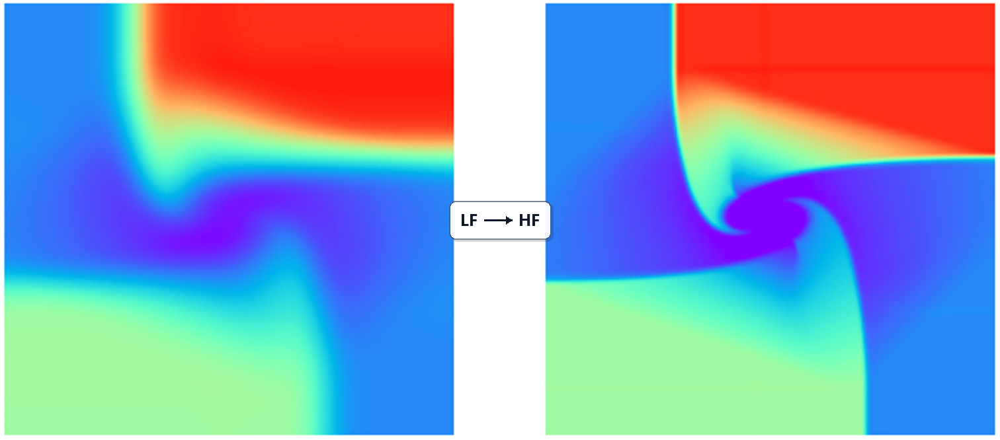
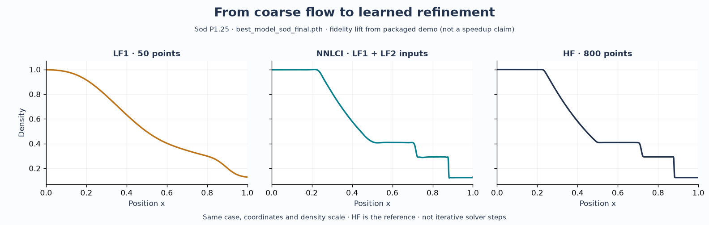
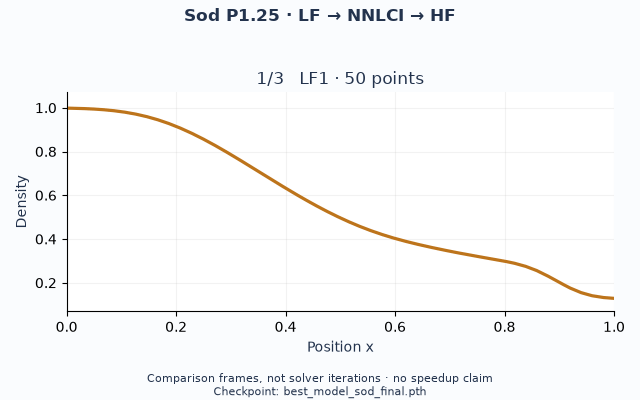
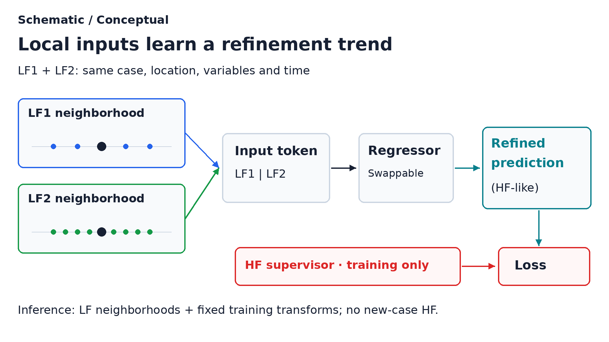

# NNLCI: Neural Networks with Local Converging Inputs

> Lift low-cost CFD solutions toward high-fidelity flow fields.

**NNLCI is a CFD-informed solution-refinement framework.** It learns to map
coarse, low-fidelity (LF) solutions to high-fidelity-like predictions of
density, velocity, and pressure. The goal is **fidelity lifting**: recover
physical structure that inexpensive CFD under-resolves, using high-fidelity
(HF) solutions as supervision during training.

This repository brings that idea into four Euler workflows: **Sod, Lax,
Woodward–Colella, and 2D Riemann Config 3**, with source, data, model
checkpoints, and evaluation scripts.

<p align="center">
  
  <br>
  <em>The objective: lift a coarse physical representation toward a more resolved
  field. This LF/HF illustration is not a benchmark of the packaged checkpoint.</em>
</p>

[Repository results](#results-from-this-repository) ·
[Why fidelity lifting?](#why-fidelity-lifting) · [How it works](#how-it-works) ·
[Choose a workflow](#choose-a-workflow) · [Installation](#installation) ·
[Run the demos](#run-the-demos) · [Adapt NNLCI](#adapting-nnlci) ·
[Repository map](#repository-layout) · [Citation](#citation)

## Results from this repository

These density fields come from the packaged Sod data and
`best_model_sod_final.pth`, evaluated on CPU with the same preprocessing and
inference logic as the repository's prediction script. This is **fidelity
lift from the packaged demo, not a surrogate speedup claim**.



*Sod P1.25 · checkpoint: `best_model_sod_final.pth` · LF | NNLCI | HF.
The displayed LF baseline is LF1 (50 points), interpolated to the 800-point
target grid. NNLCI uses both LF1 and LF2 (100 points); HF is the 800-point
reference. The three panels share the same density limits.*

<p align="center">
  
  <br>
  <em>Sod P1.25 · best_model_sod_final.pth · LF → NNLCI → HF.
  Three comparison frames of the same case, not iterative solver steps or
  a time evolution.</em>
</p>

Inspect the [P1.25 density overlay](docs/assets/promo/sod_P1.25_density_overlay.png),
the [six-case density sweep](docs/assets/promo/sod_pred_density_sweep.png), or
the [saved P1.25 arrays](docs/assets/promo/arrays/).
Regenerate the gallery with
`MPLBACKEND=Agg python scripts/promo_from_sod_results.py`.
The script checks `free -m` before plotting; if available memory falls below
2,500 MiB, it writes `sod_P1.25_fidelity_lift_strip.png` instead of the GIF.
Use that strip as the image source above when regenerating under low memory.

## Why fidelity lifting?

A coarse CFD solution already carries physical information: wave locations,
jumps, and relationships among flow variables. It can also smear shocks or
miss finer structure. NNLCI uses this imperfect solution as the starting
point for a learned refinement.

The central question is **how much HF structure can be reconstructed from
inexpensive LF solutions?** Local neighborhoods across fidelity levels give
the model evidence about how a solution changes with refinement. Near shocks
and strong gradients, that evidence includes the shape and position of a
transition, rather than just its value at one point.

Reconstruction quality comes first. Reusing a trained mapping may reduce the
cost of repeated HF simulations, but a computational-savings claim must
account for LF CFD, preprocessing, and neural refinement together. This
landing page makes no measured speedup claim.

## How it works

The included workflows use **two LF fields, LF1 and LF2**, organized around
the same target coordinates. “Converging inputs” refers to related numerical
solutions at successive fidelity levels: their local differences expose
refinement trends for the network to learn. It does not guarantee that every
point improves monotonically or that a prediction equals the HF solution.

1. **Solve related cases at multiple fidelities.** Keep physical conditions,
   variables, and output time consistent across LF and HF fields.
2. **Align and collect local inputs.** Interpolate LF1 and LF2 to target
   coordinates and gather a stencil around each point of interest.
3. **Learn the lift.** Concatenate the LF stencil values into an input vector;
   use the HF value at the same point as the training label.
4. **Refine a new LF solution.** Apply the trained model with its training
   transforms to LF stencils and assemble point predictions into a field.

<p align="center">
  
  <br>
  <em>One training sample: LF neighborhoods form the input; HF supplies the
  supervisor. The mesh drawing illustrates the concept; the packaged Euler
  demos use structured grids.</em>
</p>

**No new-case HF truth enters the model's inference inputs.** HF references
are used for training and evaluation. The supplied prediction scripts are
reproduction/evaluation tools: they load reference fields to score and plot
results. Woodward–Colella also rebuilds training transforms from the supplied
training arrays, including training HF data. A standalone deployment should
save those fixed transforms and use LF data and available coordinates for
new cases.

Locality and converging inputs are the mechanism serving the refinement
objective. Each field supplies many point-centered training samples, but
those samples do not replace independent physical cases for testing
generalization. The broader idea can accommodate different input designs;
the recipes below document the specific implementations shipped here.

For a closer look at point alignment, see the
[annotated local-stencil diagram](docs/assets/nnlci-local-stencil-explained.png).

## Choose a workflow

| Problem | LF → target data | Model input | Predicted variables |
| --- | --- | --- | --- |
| [1D Sod](#1d-sod) | 50 / 100 → 800 points | 18 features; two three-point stencils | Density, velocity, pressure |
| [1D Lax](#1d-lax) | 50 / 100 → 800 points | 30 features; two five-point stencils (primary MLP) | Density, velocity, pressure |
| [1D Woodward–Colella](#1d-woodward-colella) | 100 / 200 → 800-point target subsampled from 1600 points | 18 features; two three-point stencils | Density, velocity, pressure |
| [2D Riemann Config 3](#2d-riemann-config-3) | 100 / 200 → 800 resolution in each direction | 72 features; two dilated 3 × 3 stencils | Density, x/y velocity, pressure |

**What is included, and what it establishes:**

- **Sod and Lax:** CFD generators, training/prediction paths, and supplied
  trained checkpoints. Lax also includes an optional residual-learning branch.
- **Woodward–Colella:** supplied arrays and checkpoints; the original CFD
  batch generator is not included. See its
  [existing prediction figure and metrics](problems/1d_woodward_colella/README.md#representative-result).
- **2D Config 3:** a CUDA-Fortran solver and a bootstrap dataset formed by
  subsampling one HF solution. **This bootstrap validates software, not
  scientific multi-resolution reconstruction.** The packaged model is a
  **two-epoch pipeline-validation checkpoint**, not a publication-quality
  scientific model. The default evaluator reads training arrays, so its
  metrics are not held-out accuracy results.

See the [upload manifest](docs/UPLOAD_MANIFEST.md) for package provenance.
Scientific validation requires independently solved multi-resolution cases
and held-out physical conditions.

## Installation

Run all commands from the repository root. Linux or Ubuntu under WSL 2 fits
the supplied CFD build scripts. Python prediction can run on CPU; regenerating
Sod/Lax data needs `g++`. Regenerating 2D CFD additionally needs an NVIDIA GPU,
a working driver, and NVIDIA HPC SDK (`nvfortran`). The SDK is unnecessary
when using the supplied 2D data.

<details>
<summary>Ubuntu / WSL system packages</summary>

```bash
sudo apt update
sudo apt install -y build-essential python3 python3-venv python3-pip git git-lfs
g++ --version
```

</details>

Create a Python environment and install the repository dependencies:

```bash
python3 -m venv .venv
source .venv/bin/activate
python -m pip install --upgrade pip
python -m pip install -r requirements.txt
```

Retrieve the supplied data and weights after cloning. Arrays, weights, CFD
fields, and PDFs use Git LFS:

```bash
git lfs install
git lfs pull
```

<details>
<summary>Optional GPU setup and CUDA-Fortran compiler</summary>

Use the NVIDIA driver appropriate for your system. WSL uses the Windows host
driver; do not install a second Linux display driver inside WSL. Check access:

```bash
nvidia-smi
```

For GPU training, install a compatible CUDA-enabled PyTorch build in the same
environment. Compiler setup is separate: the supplied 2D solver requires
`nvfortran` from NVIDIA HPC SDK. Add your installed SDK compiler directory to
`PATH` (replace `YOUR_VERSION` with the actual directory name):

```bash
export PATH=/opt/nvidia/hpc_sdk/Linux_x86_64/YOUR_VERSION/compilers/bin:$PATH
nvfortran --version
```

</details>

Check the Python environment:

```bash
python -c "import torch; print('PyTorch:', torch.__version__); print('CUDA available:', torch.cuda.is_available()); print('Device:', torch.cuda.get_device_name(0) if torch.cuda.is_available() else 'CPU')"
```

## Run the demos

To inspect a supplied 1D checkpoint after installation and LFS retrieval,
start with Sod prediction:

```bash
python problems/1d_sod/src/prediction/predict.py
```

This uses supplied raw data and weights, writes figures and metrics to
`problems/1d_sod/results/predictions/`, and does not retrain the model.
Full recipes follow. Training commands write to their named checkpoints;
use the separate smoke-test filenames below when checking the code path.

### 1D Sod

The CFD script compiles `solver.cpp`, varies the left pressure, and generates
45 synchronized solutions: 9 training cases and 6 prediction cases, each on
50-, 100-, and 800-point grids.

#### Step 1.1: Generate CFD Data

```bash
python problems/1d_sod/src/cfd/generate_data.py
```

- **Reads:** `problems/1d_sod/src/cfd/solver.cpp`
- **Generates:** the executable under `src/cfd/bin/` and files such as
  `train_P1.00_50.dat` and `pred_P1.25_800.dat` under
  `problems/1d_sod/data/raw/`

Optional data-quality check:

```bash
python problems/1d_sod/src/preprocessing/check_data_quality.py
```

#### Step 1.2: Train

Preprocessing is performed inside the training script. The 50- and 100-point
solutions are interpolated to the target coordinates, dual three-point
stencils are extracted, and an 18-feature MLP is trained.

```bash
python problems/1d_sod/src/training/train.py
```

- **Reads:** `data/raw/train_P*_50.dat`, `train_P*_100.dat`, and
  `train_P*_800.dat`
- **Generates:** `problems/1d_sod/models/best_model_sod_final.pth`
- **Default:** 4000 epochs. For a quick smoke test, run
  `NNLCI_EPOCHS=1 NNLCI_MODEL_FILENAME=smoke_sod.pth python problems/1d_sod/src/training/train.py`.

#### Step 1.3: Predict and Visualize

```bash
python problems/1d_sod/src/prediction/predict.py
```

- **Reads:** prediction `.dat` files and `models/best_model_sod_final.pth`
- **Generates:** prediction figures and reported errors under
  `problems/1d_sod/results/predictions/`

### 1D Lax

The Lax workflow has a primary MLP branch and an optional residual-learning
ResNet branch. The CFD generator creates 48 files: 11 training cases and 5
prediction cases at three resolutions.

#### Step 2.1: Generate and Verify CFD Data

```bash
python problems/1d_lax/src/cfd/generate_data.py
python problems/1d_lax/src/preprocessing/verify_data.py
```

- **Reads:** `problems/1d_lax/src/cfd/solver.cpp`
- **Generates:** the compiled solver under `src/cfd/bin/` and
  `train_P*_50.dat`, `train_P*_100.dat`, `train_P*_800.dat`, plus the
  corresponding `pred_P*` files under `problems/1d_lax/data/raw/`

#### Step 2.2: Train and Run the Primary MLP

```bash
python problems/1d_lax/src/training/train_mlp.py
python problems/1d_lax/src/prediction/predict_mlp.py
```

- **Training reads:** synchronized training `.dat` files at 50, 100, and 800
  points; preprocessing and dual five-point stencil extraction occur in the
  training script
- **Training generates:** `problems/1d_lax/models/best_model_lax_final.pth`
- **Prediction reads:** prediction `.dat` files and the trained checkpoint
- **Prediction generates:** figures and metrics under
  `problems/1d_lax/results/mlp/`

For a one-epoch check, prefix the training command with
`NNLCI_EPOCHS=1 NNLCI_MODEL_FILENAME=smoke_lax.pth`.

#### Step 2.3: Optional Residual-Learning Branch

```bash
python problems/1d_lax/src/training/train_resnet.py
python problems/1d_lax/src/prediction/predict_resnet.py
```

This branch generates/reads `models/best_model_lax_resnet.pth` and writes its
results to `problems/1d_lax/results/resnet/`.

### 1D Woodward-Colella

The repository includes precomputed 100-, 200-, and 1600-point NumPy arrays.
The original CFD batch generator is not included, so this workflow begins
with the supplied arrays. The 1600-point solution is subsampled to form the
800-point target.

#### Step 3.1: Check the Supplied Data

The training script reads these files from
`problems/1d_woodward_colella/data/raw/`:

- `training_dataset_100.npy`
- `training_dataset_200.npy`
- `training_dataset_hf.npy`

#### Step 3.2: Train

```bash
python problems/1d_woodward_colella/src/run.py train --epochs 10000 --model best_model_800.pth
```

Preprocessing and dual three-point stencil extraction occur inside the
training code. The command generates
`problems/1d_woodward_colella/models/best_model_800.pth`. Use `--epochs 1`
and a different `--model` filename for a smoke test so the supplied checkpoint
is not overwritten.

#### Step 3.3: Predict

```bash
python problems/1d_woodward_colella/src/run.py predict --model best_model_800.pth
```

The prediction command reads the supplied arrays and checkpoint, reports
relative errors, and writes prediction arrays/figures under
`problems/1d_woodward_colella/results/`. A representative result figure is
shown in the [Woodward-Colella problem README](problems/1d_woodward_colella/README.md).

### 2D Riemann Config 3

The 2D CFD code is a CUDA-Fortran characteristic-wise WENO-5 solver for the
Euler equations. The NNLCI pipeline aligns 100- and 200-resolution fields to
an 800-resolution field, applies shock-aware sampling, extracts dual local
stencils, and trains a deep MLP.

The standard Config 3 initial states generated by the repository are:

| Quadrant | Density | x velocity | y velocity | Pressure |
| --- | ---: | ---: | ---: | ---: |
| Q1 | 1.5000 | 0.000 | 0.000 | 1.500 |
| Q2 | 0.5323 | 1.206 | 0.000 | 0.300 |
| Q3 | 0.1380 | 1.206 | 1.206 | 0.029 |
| Q4 | 0.5323 | 0.000 | 1.206 | 0.300 |

#### Step 4.1: Generate the Fortran Configuration

```bash
python problems/2d_riemann/src/cfd/generate_configs.py
```

- **Generates:** `problems/2d_riemann/configs/input_Config3_std.nml`
  and other standard configurations supported by the script

#### Step 4.2: Compile and Run the CFD Solver

```bash
mkdir -p problems/2d_riemann/src/cfd/bin
nvfortran -O3 -cuda problems/2d_riemann/src/cfd/weno_gpu_solver.f90 \
  -o problems/2d_riemann/src/cfd/bin/weno_gpu_solver
python problems/2d_riemann/src/cfd/run_solver.py
```

- **Reads:** the Config 3 `.nml` file
- **Generates:** `problems/2d_riemann/data/raw/flow_standard_config3.dat`

The runner above generates the single standard field, not a multi-case,
multi-resolution training set. For scientific training, configure and solve
each independently perturbed case at 100, 200, and 800 resolutions and arrange
it as (case directories must match `case_*`):

```text
problems/2d_riemann/data/bootstrap/DATA_TRAIN/Config3/case_001/
|-- flow_100x100.dat
|-- flow_200x200.dat
`-- flow_800x800.dat
```

Choose perturbations of initial pressure, density, or velocity appropriate to
your experiment, and reserve independent cases for testing. Keep scientific
data separate from the bootstrap case; `preprocess.py` reads `case_*` folders
under its configured `DATA_ROOT`.

#### Step 4.3: Build the Included Software-Validation Dataset

To reproduce the code path using the supplied standard 801-by-801 node field:

```bash
python problems/2d_riemann/src/preprocessing/prepare_config3_bootstrap.py
```

This writes one aligned case under `data/bootstrap/DATA_TRAIN/Config3/` by
subsampling the same high-resolution solution. It validates the software
pipeline only; it is **not** a substitute for independently solved
multi-resolution CFD data in a scientific experiment.

#### Step 4.4: Preprocess and Sample Stencils

```bash
python problems/2d_riemann/src/preprocessing/preprocess.py
```

The script:

1. reads the 100-, 200-, and 800-resolution Tecplot fields;
2. bilinearly aligns the two low-fidelity fields to the target grid;
3. uses HF gradients to prioritize shock regions for training samples;
4. extracts two dilated 3 × 3 stencils (2 × 9 points × 4 variables = 72 features); and
5. scales physical variables to the range used by the `Tanh` network.

It generates:

```text
problems/2d_riemann/data/processed/NNLCI_Data/Config3_Stencils/
|-- train_input_config3.npy
|-- train_target_config3.npy
`-- x_scaler_config3.npz
```

#### Step 4.5: Train the Deep MLP

```bash
NNLCI_EPOCHS=500 NNLCI_NUM_WORKERS=8 \
python problems/2d_riemann/src/training/train.py
```

- **Reads:** `train_input_config3.npy` and `train_target_config3.npy` using
  memory mapping
- **Generates:**
  `problems/2d_riemann/models/NNLCI_Models/nnlci_config3_deep_latest.pth`
- **Defaults:** batch size 65536, AdamW learning rate `1e-4`, and 500 epochs

For a quick check, use `NNLCI_EPOCHS=1 NNLCI_NUM_WORKERS=0`. Training uses
CUDA automatically when available.

#### Step 4.6: Evaluate

```bash
NNLCI_NUM_WORKERS=0 python problems/2d_riemann/src/prediction/evaluate.py
```

The evaluator reads `train_input_config3.npy`, `train_target_config3.npy`,
and the Config 3 checkpoint. This evaluates the processed training samples,
not held-out cases. It prints MAE, MSE, relative L1/L2 error, PSNR, and SSIM when the sample shape permits. It
generates
`problems/2d_riemann/results/NNLCI_Output/predictions_config3.npy`.

## Adapting NNLCI

Start with the data contract: synchronized physical cases, consistent units,
variables, boundary conditions, and output times. A different solver or mesh
requires corresponding alignment and stencil code; this package does not
provide ready-made adapters for other CFD tools.

- **Organize the lift.** Choose LF sources and a trusted HF target. Keep
  stencil size, flattening order, boundary handling, and normalization
  consistent between training and prediction.
- **Separate training from deployment.** Fit transforms on training cases and
  persist them. HF labels and HF-based sample selection belong to training
  and evaluation; prediction of a new case must use available LF information.
- **Match the model to the inputs.** Adjust input/output widths for the number
  of variables, LF levels, and stencil points. The objective remains solution
  refinement when the architecture changes.
- **Validate physical cases.** Hold out entire cases when testing
  generalization; neighboring points from one field are not independent test
  cases. Inspect shocks, contacts, and smooth regions alongside per-variable
  errors, and compare with the LF baseline.
- **Check the pipeline before scaling up.** Inspect aligned fields, finite
  values, array shapes, and transforms; run a one-epoch smoke test. Any cost
  comparison should include LF generation and the full refinement path.

## Repository Layout

```text
NNLCI/
|-- problems/
|   |-- 1d_sod/
|   |-- 1d_lax/
|   |-- 1d_woodward_colella/
|   `-- 2d_riemann/
|-- common/       optional reusable models, data processing, and metrics
|-- docs/         assets, package manifest, intro draft, and legacy docs
|-- scripts/      repository maintenance and asset-preparation scripts
|-- CITATION.cff
|-- README.md
|-- requirements.txt
`-- LICENSE
```

Each problem keeps source code, data, models, and results separate. The
[common utilities](common/README.md) are available for new experiments; the
problem scripts remain self-contained. Historical recipes under `docs/legacy/`
and `docs/getting_started_legacy.md` retain old paths; use the commands above.

Python paths are resolved from the script location, so the documented commands can be
run from the repository root without editing working directories.

## Software Authors

Jinbo Xiao, Weiming Ding, Li-Chian Yao, Yingjie Liu, Haoxiang Huang,
Vigor Yang, I-Hsuan She, and Haotian Sun.

## Citation

For software attribution, use [CITATION.cff](CITATION.cff). If you use NNLCI
in research, please also cite the relevant papers. Parts I and II introduce
the 1D and 2D NNLCI methods; the AIAA Journal paper demonstrates an extension
to unstructured-grid CFD.

```bibtex
@article{huang2023nnlci_part1,
  title={Neural networks with local converging inputs (NNLCI) for solving conservation laws, Part I: 1D problems},
  author={Huang, Haoxiang and Yang, Vigor and Liu, Yingjie},
  journal={Communications in Computational Physics},
  volume={34},
  number={2},
  pages={290--317},
  year={2023},
  doi={10.4208/cicp.OA-2022-0285}
}

@article{huang2023nnlci_part2,
  title={Neural networks with local converging inputs (NNLCI) for solving conservation laws, Part II: 2D problems},
  author={Huang, Haoxiang and Yang, Vigor and Liu, Yingjie},
  journal={Communications in Computational Physics},
  volume={34},
  number={4},
  pages={907--933},
  year={2023},
  doi={10.4208/cicp.OA-2023-0026}
}

@article{ding2024nnlci_unstructured,
  title={Neural network with local converging input for unstructured-grid computational fluid dynamics},
  author={Ding, Weiming and Huang, Haoxiang and Lee, Tzu-Jung and Liu, Yingjie and Yang, Vigor},
  journal={AIAA Journal},
  volume={62},
  number={8},
  pages={3155--3166},
  year={2024},
  doi={10.2514/1.J063885}
}
```

## License

Released under the [MIT License](LICENSE).
