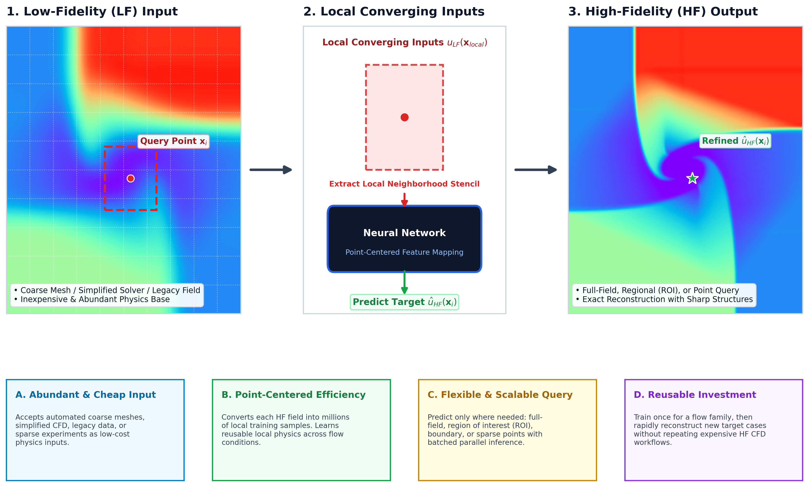
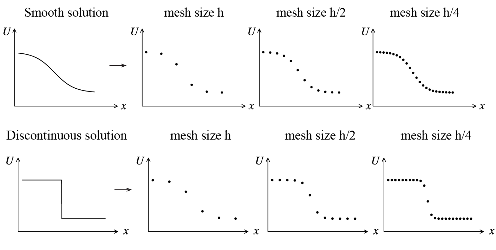
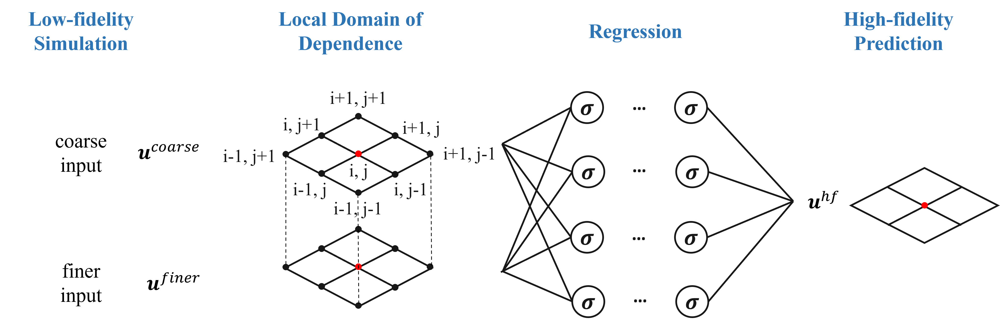

# NNLCI: Neural Networks with Local Converging Inputs

> A data-centric framework for reconstructing high-fidelity flow fields from
> inexpensive, imperfect, and physics-bearing low-fidelity data.

NNLCI learns local mappings from low-fidelity flow information to
high-fidelity targets. The examples in this repository use two low-fidelity
fields, LF1 and LF2, because that is a convenient converging sequence for the
included Euler workflows. The broader NNLCI idea is not limited to exactly two
LF inputs: the key requirement is local physics information that is aligned
with the point or region being reconstructed.

<p align="center">
  
</p>

<p align="center">
  <em>
    Low-fidelity data does not need to be the final answer.<br>
    It only needs to contain enough physics to guide high-fidelity reconstruction.
  </em>
</p>

## Why NNLCI?

- **High-fidelity CFD is expensive beyond runtime.** It requires mesh design,
  numerical-scheme choices, CFD model selection, stabilization, and validation.
- **Low-fidelity data can be cheap and repeatable.** It may come from coarse
  grids, auto-meshed simulations, simplified models, under-resolved CFD, or
  legacy data.
- **Imperfect does not mean uninformative.** LF fields can still carry
  geometry, boundary-condition, wave-structure, and trend information.
- **Shock waves and strong gradients are first-class targets.** Local LF
  patches retain how steep structures change across space and resolution,
  giving NNLCI more information than an isolated point value.
- **NNLCI turns local LF information into HF predictions.** During training,
  the HF value at the same point of interest is used as the supervisor.
  During inference, the model only needs the local LF neighborhood.
- **Each HF case becomes many training samples.** Point-centered learning
  improves the value of limited HF data and supports low-dataset,
  high-generalization workflows within a related problem family.
- **Inference is flexible.** The same trained model can reconstruct a full
  field, a region, a boundary, or sparse points, then batch or parallelize
  those point queries and assemble the result afterward.

## The NNLCI Philosophy

- **Data structure matters.** NNLCI is built around how multi-fidelity physics
  data is sampled, aligned, normalized, and reused.
- **Learn locally, reuse globally.** The model learns local flow relationships
  that can be applied across many points and related cases.
- **Use LF as input, HF as supervision.** HF data teaches the mapping during
  training; it is not required at prediction time.
- **Converging sequences help, but are not sacred.** LF1/LF2/HF is useful in
  these examples because it exposes resolution trends. Other LF sources can be
  adapted when they provide aligned local physics information.
- **Move cost from repetition to learning.** Build representative HF data
  once, train the local reconstruction model, then reuse it for faster
  predictions on new related cases.

<p align="center">
  
</p>

### Local Patches Around Shocks

NNLCI is especially well suited to shock-wave and strong-gradient flows:

- In smooth regions, neighboring samples change gradually as the mesh is
  refined.
- Near a shock or discontinuity, the local patch records the jump, its
  location, and how the transition sharpens across fidelity levels.
- NNLCI learns these local multi-fidelity signatures and maps them to the HF
  value at the point of interest without assuming that the solution is smooth.

<p align="center">
  
</p>

## How NNLCI Works

NNLCI converts each high-fidelity field into many point-centered learning
samples:

1. Generate or collect LF and HF solutions for related physical cases.
2. Align LF fields to the target coordinates or points of interest.
3. Extract local LF stencils around each target point.
4. Use the HF value at that same point as the supervised training target.
5. Train a neural network to map local LF patterns to the HF target value.
6. Query the model at any requested points and reconstruct the output field.

<p align="center">
  
</p>

<p align="center">
  
</p>

## Included Workflows

This repository contains reproducible workflows for three 1D Euler problems
and one 2D Riemann problem.

| Problem | Fidelity levels in this repo | NNLCI input | Prediction target |
| --- | --- | --- | --- |
| [1D Sod](problems/1d_sod/README.md) | 50 / 100 / 800 points | 18 features from dual three-point LF stencils | density, velocity, pressure |
| [1D Lax](problems/1d_lax/README.md) | 50 / 100 / 800 points | 30 features from dual five-point LF stencils | density, velocity, pressure |
| [1D Woodward-Colella](problems/1d_woodward_colella/README.md) | 100 / 200 / 1600 points; 800-point target | 18 features from dual three-point LF stencils | density, velocity, pressure |
| [2D Riemann, Config 3](problems/2d_riemann/README.md) | 100^2 / 200^2 / 800^2 grids | 72 features from aligned dual LF spatial stencils | density, x/y velocity, pressure |

All commands below are run from the repository root. Linux or Ubuntu under
WSL 2 is recommended because the CFD build scripts use `g++` and
`nvfortran`.

## 0. Install Drivers and Environment

The 1D workflows need Python and a C++ compiler. The supplied 2D
CUDA-Fortran CFD solver additionally needs an NVIDIA GPU, NVIDIA driver, and
NVIDIA HPC SDK. The Python prediction scripts can also run on CPU, although
training is considerably faster on a CUDA-capable GPU.

### 0.1 NVIDIA GPU Driver

- **Windows/WSL 2:** install a current Game Ready or Studio driver from the
  [NVIDIA driver download page](https://www.nvidia.com/download/index.aspx),
  restart Windows, and enable/install WSL 2 with Ubuntu.
- **Native Linux:** install the driver recommended for the Linux distribution,
  reboot, and verify it with:

```bash
nvidia-smi
```

Do not install a second Linux display driver inside WSL; WSL uses the Windows
host driver.

### 0.2 C++ Compiler for the 1D CFD Solvers

On Ubuntu or WSL Ubuntu:

```bash
sudo apt update
sudo apt install -y build-essential python3 python3-venv python3-pip git git-lfs
g++ --version
```

### 0.3 NVIDIA HPC SDK for the 2D CFD Solver

`problems/2d_riemann/src/cfd/weno_gpu_solver.f90` uses CUDA Fortran and must
be compiled with `nvfortran`, which is supplied by the
[NVIDIA HPC SDK](https://developer.nvidia.com/hpc-sdk). Install the SDK for
your Linux distribution, then add its compiler directory to `PATH`. The exact
version directory depends on the installed release; for example:

```bash
export PATH=/opt/nvidia/hpc_sdk/Linux_x86_64/<version>/compilers/bin:$PATH
export MANPATH=/opt/nvidia/hpc_sdk/Linux_x86_64/<version>/compilers/man:$MANPATH
nvfortran --version
```

Add the two `export` lines, with `<version>` replaced, to `~/.bashrc` if they
should persist. The HPC SDK is optional when using the included 2D raw or
bootstrap data without regenerating CFD solutions.

### 0.4 Python Environment

Create one environment for all four workflows:

```bash
python3 -m venv .venv
source .venv/bin/activate
python -m pip install --upgrade pip
```

For GPU training, first install the PyTorch build matching the system from the
[official PyTorch selector](https://pytorch.org/get-started/locally/). For
example, if that selector recommends CUDA 12.1:

```bash
python -m pip install torch torchvision torchaudio --index-url https://download.pytorch.org/whl/cu121
python -m pip install -r requirements.txt
```

For CPU-only execution, use:

```bash
python -m pip install -r requirements.txt
```

Verify the environment:

```bash
python -c "import torch; print('PyTorch:', torch.__version__); print('CUDA available:', torch.cuda.is_available()); print('Device:', torch.cuda.get_device_name(0) if torch.cuda.is_available() else 'CPU')"
```

### 0.5 Large Files After Cloning

The repository routes `.npy`, `.npz`, `.pth`, `.dat`, and `.pdf` files through
Git LFS. After cloning, retrieve them with:

```bash
git lfs install
git lfs pull
```

## 1. Run the 1D Sod Problem

The CFD script compiles `solver.cpp`, varies the left pressure, and generates
45 synchronized solutions: 9 training cases and 6 prediction cases, each on
50-, 100-, and 800-point grids.

### Step 1.1: Generate CFD Data

```bash
python problems/1d_sod/src/cfd/generate_data.py
```

- **Reads:** `problems/1d_sod/src/cfd/solver.cpp`
- **Generates:** the executable under `src/cfd/bin/` and files such as
  `train_P1.00_50.dat` and `pred_P1.25_800.dat` under
  `problems/1d_sod/data/raw/`

Optional data-quality check:

```bash
python problems/1d_sod/src/preprocessing/check_data_quality.py
```

### Step 1.2: Train

Preprocessing is performed inside the training script. The 50- and 100-point
solutions are interpolated to the target coordinates, dual three-point
stencils are extracted, and an 18-feature MLP is trained.

```bash
python problems/1d_sod/src/training/train.py
```

- **Reads:** `data/raw/train_P*_50.dat`, `train_P*_100.dat`, and
  `train_P*_800.dat`
- **Generates:** `problems/1d_sod/models/best_model_sod_final.pth`
- **Default:** 4000 epochs. For a quick smoke test, run
  `NNLCI_EPOCHS=1 NNLCI_MODEL_FILENAME=smoke_sod.pth python problems/1d_sod/src/training/train.py`.

### Step 1.3: Predict and Visualize

```bash
python problems/1d_sod/src/prediction/predict.py
```

- **Reads:** prediction `.dat` files and `models/best_model_sod_final.pth`
- **Generates:** prediction figures and reported errors under
  `problems/1d_sod/results/predictions/`

## 2. Run the 1D Lax Problem

The Lax workflow has a primary MLP branch and an optional residual-learning
ResNet branch. The CFD generator creates 48 files: 11 training cases and 5
prediction cases at three resolutions.

### Step 2.1: Generate and Verify CFD Data

```bash
python problems/1d_lax/src/cfd/generate_data.py
python problems/1d_lax/src/preprocessing/verify_data.py
```

- **Reads:** `problems/1d_lax/src/cfd/solver.cpp`
- **Generates:** the compiled solver under `src/cfd/bin/` and
  `train_P*_50.dat`, `train_P*_100.dat`, `train_P*_800.dat`, plus the
  corresponding `pred_P*` files under `problems/1d_lax/data/raw/`

### Step 2.2: Train and Run the Primary MLP

```bash
python problems/1d_lax/src/training/train_mlp.py
python problems/1d_lax/src/prediction/predict_mlp.py
```

- **Training reads:** synchronized training `.dat` files at 50, 100, and 800
  points; preprocessing and dual five-point stencil extraction occur in the
  training script
- **Training generates:** `problems/1d_lax/models/best_model_lax_final.pth`
- **Prediction reads:** prediction `.dat` files and the trained checkpoint
- **Prediction generates:** figures and metrics under
  `problems/1d_lax/results/mlp/`

For a one-epoch check, prefix the training command with
`NNLCI_EPOCHS=1 NNLCI_MODEL_FILENAME=smoke_lax.pth`.

### Step 2.3: Optional Residual-Learning Branch

```bash
python problems/1d_lax/src/training/train_resnet.py
python problems/1d_lax/src/prediction/predict_resnet.py
```

This branch generates/reads `models/best_model_lax_resnet.pth` and writes its
results to `problems/1d_lax/results/resnet/`.

## 3. Run the 1D Woodward-Colella Problem

The repository includes precomputed 100-, 200-, and 1600-point NumPy arrays.
The original CFD batch generator is not included, so this workflow begins
with the supplied arrays. The 1600-point solution is subsampled to form the
800-point target.

### Step 3.1: Check the Supplied Data

The training script reads these files from
`problems/1d_woodward_colella/data/raw/`:

- `training_dataset_100.npy`
- `training_dataset_200.npy`
- `training_dataset_hf.npy`

### Step 3.2: Train

```bash
python problems/1d_woodward_colella/src/run.py train --epochs 10000 --model best_model_800.pth
```

Preprocessing and dual three-point stencil extraction occur inside the
training code. The command generates
`problems/1d_woodward_colella/models/best_model_800.pth`. Use `--epochs 1`
and a different `--model` filename for a smoke test so the supplied checkpoint
is not overwritten.

### Step 3.3: Predict

```bash
python problems/1d_woodward_colella/src/run.py predict --model best_model_800.pth
```

The prediction command reads the supplied arrays and checkpoint, reports
relative errors, and writes prediction arrays/figures under
`problems/1d_woodward_colella/results/`. A representative result figure is
shown in the [Woodward-Colella problem README](problems/1d_woodward_colella/README.md).

## 4. Run the 2D Riemann Problem (Config 3)

The 2D CFD code is a CUDA-Fortran characteristic-wise WENO-5 solver for the
Euler equations. The NNLCI pipeline aligns 100- and 200-resolution fields to
an 800-resolution field, applies shock-aware sampling, extracts dual local
stencils, and trains a deep MLP.

The standard Config 3 initial states generated by the repository are:

| Quadrant | Density | x velocity | y velocity | Pressure |
| --- | ---: | ---: | ---: | ---: |
| Q1 | 1.5000 | 0.000 | 0.000 | 1.500 |
| Q2 | 0.5323 | 1.206 | 0.000 | 0.300 |
| Q3 | 0.1380 | 1.206 | 1.206 | 0.029 |
| Q4 | 0.5323 | 0.000 | 1.206 | 0.300 |

### Step 4.1: Generate the Fortran Configuration

```bash
python problems/2d_riemann/src/cfd/generate_configs.py
```

- **Generates:** `problems/2d_riemann/configs/input_Config3_std.nml`
  and other standard configurations supported by the script

### Step 4.2: Compile and Run the CFD Solver

```bash
mkdir -p problems/2d_riemann/src/cfd/bin
nvfortran -O3 -cuda problems/2d_riemann/src/cfd/weno_gpu_solver.f90 \
  -o problems/2d_riemann/src/cfd/bin/weno_gpu_solver
python problems/2d_riemann/src/cfd/run_solver.py
```

- **Reads:** the Config 3 `.nml` file
- **Generates:** `problems/2d_riemann/data/raw/flow_standard_config3.dat`

For scientific training, solve each independently perturbed case at 100, 200,
and 800 resolutions and arrange it as:

```text
problems/2d_riemann/data/bootstrap/DATA_TRAIN/Config3/<case_name>/
|-- flow_100x100.dat
|-- flow_200x200.dat
`-- flow_800x800.dat
```

Varying the initial pressure, density, or velocity by values such as +/-5%
and +/-10% expands the training solution space.

### Step 4.3: Build the Included Software-Validation Dataset

To reproduce the code path using the supplied standard 801-by-801 node field:

```bash
python problems/2d_riemann/src/preprocessing/prepare_config3_bootstrap.py
```

This writes one aligned case under `data/bootstrap/DATA_TRAIN/Config3/` by
subsampling the same high-resolution solution. It validates the software
pipeline only; it is **not** a substitute for independently solved
multi-resolution CFD data in a scientific experiment.

### Step 4.4: Preprocess and Sample Stencils

```bash
python problems/2d_riemann/src/preprocessing/preprocess.py
```

The script:

1. reads the 100-, 200-, and 800-resolution Tecplot fields;
2. bilinearly aligns the two low-fidelity fields to the target grid;
3. prioritizes high-gradient shock regions with smart sampling;
4. extracts the dual spatial stencil and creates a 72-feature input; and
5. scales physical variables to the range used by the `Tanh` network.

It generates:

```text
problems/2d_riemann/data/processed/NNLCI_Data/Config3_Stencils/
|-- train_input_config3.npy
|-- train_target_config3.npy
`-- x_scaler_config3.npz
```

### Step 4.5: Train the Deep MLP

```bash
NNLCI_EPOCHS=500 NNLCI_NUM_WORKERS=8 \
python problems/2d_riemann/src/training/train.py
```

- **Reads:** `train_input_config3.npy` and `train_target_config3.npy` using
  memory mapping
- **Generates:**
  `problems/2d_riemann/models/NNLCI_Models/nnlci_config3_deep_latest.pth`
- **Defaults:** batch size 65536, Adam learning rate `1e-4`, and 500 epochs

For a quick check, use `NNLCI_EPOCHS=1 NNLCI_NUM_WORKERS=0`. Training uses
CUDA automatically when available.

### Step 4.6: Evaluate

```bash
NNLCI_NUM_WORKERS=0 python problems/2d_riemann/src/prediction/evaluate.py
```

The evaluator reads the processed arrays and Config 3 checkpoint, prints MAE,
MSE, relative L1/L2 error, PSNR, and SSIM when the sample shape permits. It
generates
`problems/2d_riemann/results/NNLCI_Output/predictions_config3.npy`.

## 5. Execution Summary

```text
1D Sod/Lax:
CFD generation -> interpolation/stencil preprocessing -> training -> prediction

1D Woodward-Colella:
supplied arrays -> interpolation/stencil preprocessing -> training -> prediction

2D Riemann Config 3:
configuration -> CFD at three resolutions -> preprocessing/smart sampling
-> train_input_config3.npy + train_target_config3.npy
-> training -> nnlci_config3_deep_latest.pth -> evaluation
```

## 6. Adapting NNLCI to a New Problem

NNLCI is modular. The supplied WENO solvers can be replaced with another CFD
code, including OpenFOAM, Ansys Fluent, STAR-CCM+, an in-house solver, a
reduced-order model, experimental data, or a solver for another system of
conservation laws.

### 6.1 Prepare Multi-Fidelity Data

- Choose one or more inexpensive LF sources and a trusted HF target source.
- Keep variables, units, domain definition, boundary conditions, output time,
  and variable ordering consistent.
- Create multiple physical cases by varying initial conditions, boundary
  conditions, geometry, or model parameters.
- Reserve held-out cases for validation and testing. Do not split neighboring
  points from the same field across train/test if case-level generalization is
  the goal.

### 6.2 Align Coordinates and Extract Local Inputs

- Interpolate or project LF data to the requested target coordinates.
- Around each point of interest, gather a local LF neighborhood.
- Use the HF value at the same point only as the training supervisor.
- Keep stencil size, padding, flattening order, and normalization consistent
  between training and prediction.
- Fit normalization parameters on training cases only and reuse them for
  validation, testing, and inference.

### 6.3 Sample the Right Physics

- Dense HF fields can contain many redundant smooth points.
- Shock-aware or gradient-aware sampling can make training more efficient.
- Inspect rare but important structures: contacts, shear layers, reacting
  fronts, wall layers, separated regions, or geometric singularities.
- Adjust sampling ratios for the new flow regime instead of assuming density
  gradients alone capture every important feature.

### 6.4 Adapt the Model and Outputs

- Change the input width when stencil size, spatial dimension, number of LF
  sources, or number of variables changes.
- Change the output width to match the HF target variables.
- Keep training, prediction, and post-processing definitions synchronized.
- For large datasets, retain memory-mapped loading and tune batch size and
  worker count for available RAM and GPU memory.

### 6.5 Validate Before Long Runs

- Verify every field is finite and physically admissible.
- Plot LF and HF fields on common coordinates.
- Run preprocessing on one case and inspect array shapes and scaling.
- Overfit a very small sample to test the model/data connection.
- Run a one-epoch end-to-end smoke test.
- Report per-variable and global relative errors together with visual checks
  of important flow features.

The Config 3 bootstrap in this repository is useful for software validation,
but a scientific accuracy claim requires independently computed
multi-resolution solutions and held-out physical cases.

## Repository Layout

```text
NNLCI/
|-- problems/
|   |-- 1d_sod/
|   |-- 1d_lax/
|   |-- 1d_woodward_colella/
|   `-- 2d_riemann/
|-- common/       reusable models, data processing, and error metrics
|-- docs/         assets and legacy documentation
|-- scripts/      repository maintenance and asset-preparation scripts
|-- CITATION.cff
|-- README.md
|-- requirements.txt
`-- LICENSE
```

Each problem keeps source code, data, models, and results separate. Python
paths are resolved from the script location, so the documented commands can be
run from the repository root without editing working directories.

## Software Authors and Project Roles

- **Jinbo Xiao:** repository integrator and GPU code developer
- **Weiming Ding and Li-Chian Yao:** new-method exploration and extensions
- **Yingjie Liu and Haoxiang Huang:** NNLCI creators
- **Vigor Yang:** project director

## Citation

For software attribution, use [CITATION.cff](CITATION.cff). If you use NNLCI
in research, please also cite the relevant papers. Parts I and II introduce
the 1D and 2D NNLCI methods; the AIAA Journal paper demonstrates an extension
to unstructured-grid CFD.

```bibtex
@article{huang2023nnlci_part1,
  title={Neural networks with local converging inputs (NNLCI) for solving conservation laws, Part I: 1D problems},
  author={Huang, Haoxiang and Yang, Vigor and Liu, Yingjie},
  journal={Communications in Computational Physics},
  volume={34},
  number={2},
  pages={290--317},
  year={2023},
  doi={10.4208/cicp.OA-2022-0285}
}

@article{huang2023nnlci_part2,
  title={Neural networks with local converging inputs (NNLCI) for solving conservation laws, Part II: 2D problems},
  author={Huang, Haoxiang and Yang, Vigor and Liu, Yingjie},
  journal={Communications in Computational Physics},
  volume={34},
  number={4},
  pages={907--933},
  year={2023},
  doi={10.4208/cicp.OA-2023-0026}
}

@article{ding2024nnlci_unstructured,
  title={Neural network with local converging input for unstructured-grid computational fluid dynamics},
  author={Ding, Weiming and Huang, Haoxiang and Lee, Tzu-Jung and Liu, Yingjie and Yang, Vigor},
  journal={AIAA Journal},
  volume={62},
  number={8},
  pages={3155--3166},
  year={2024},
  doi={10.2514/1.J063885}
}
```

## License

See [LICENSE](LICENSE).
