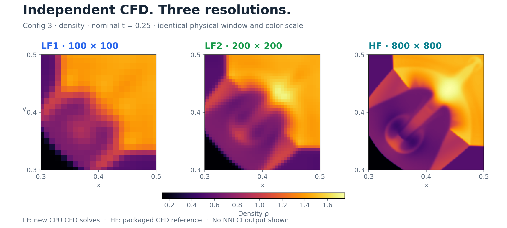
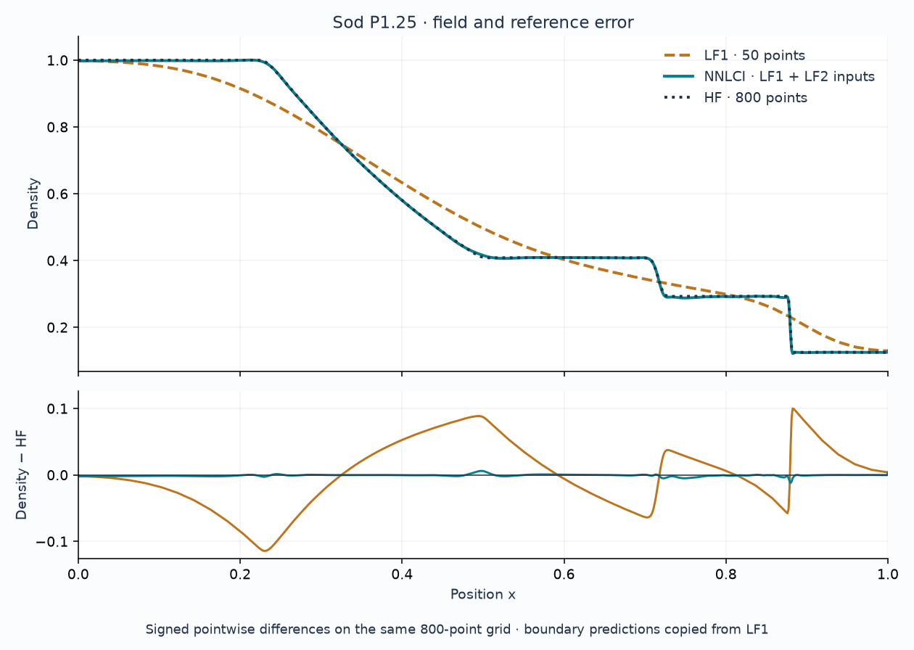
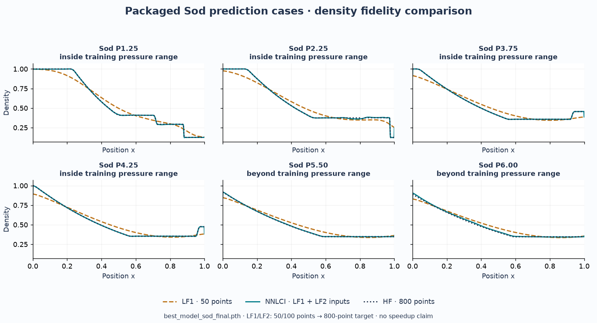

# Visual gallery · independent CFD, workflow, checkpoint evidence

[Project overview](../../../README.md) · [Figure tools](../../figure_tools/README.md) ·
[Documentation](../../README.md)

## 2D fields and the motion open



**LF1 and LF2 are separate CFD simulations.** They start from the repository's
standard Config 3 quadrant states, using 100 and 200 intervals per axis
(101 × 101 and 201 × 201 nodes), γ = 1.4, dt = 0.0001, t = 0.25 and transmissive
boundaries. Both use a serial CPU adapter of the repository's CUDA-Fortran
characteristic WENO5-JS / RK3 kernels. No HF file enters either solve.
[Fields, configurations, logs and hashes](../../../problems/2d_riemann/data/promo_cfd/)
are separate from the unchanged bootstrap/training data.

The **HF target** is the existing 801 × 801
[`flow_standard_config3.dat`](../../../problems/2d_riemann/data/raw/flow_standard_config3.dat),
with nominal setup from the repository's standard configuration. Its original
execution log is unavailable, so exact historical run settings are not independently
verified. It was neither regenerated nor produced by NNLCI in this pass.
The CPU adapter preserves numerical expressions and changes execution/storage;
GPU/CPU parity could not be tested without NVIDIA hardware. This is one CFD case
for the figures, not a new training ensemble or held-out NNLCI validation.

### Presentation and motion

The [POI opening](nnlci_local_to_hf.gif) drops the same point of interest onto
both LF planes, first at a sharp transition (0.34, 0.44), then in a smooth region
(0.46, 0.48). Both planes show x/y = 0.30–0.50 with the same projection and a
shared linear density scale. Native nearest-node colors expose the actual CFD
sampling; no blur, artificial sharpening or HF-derived LF data is used.

**The highlighted patches have identical physical size: 0.04 × 0.04.** At the
chosen common grid nodes, a closed patch contains 5 × 5 LF1 nodes and 9 × 9 LF2
nodes, including its boundary. Enlarged insets use the same display size, so the
extra LF2 information is visible in the same space. These are native sample
counts, not neural-network feature counts. The mechanism still takes two
**aligned 3 × 3 stencils × four variables = 72 scalar features**.

The camera then rotates from tilted planes to a top-down 2D view. Repeated POIs
fill a puzzle-like mosaic of grouped point predictions. That teal panel is
labeled **“Schematic · illustrative colors”** and **“No model output shown”**
throughout. Its piecewise analytic motif illustrates a sharp interface and a
smooth region; it contains neither HF data nor model predictions. The expression
is recorded in [render provenance](gatech_provenance.json). Field values remain
fixed at the final CFD time; motion is a workflow explanation, not a simulation.
The separate scientific comparison above retains the actual packaged HF target.

The [poster](nnlci_motion_poster.png) preserves the equal-patch opening; the
[three-scene storyboard](nnlci_local_to_hf_concept.png) also preserves landing,
the turn to 2D, and the completed schematic field without requiring motion.
The [mechanism](nnlci_local_mechanism.png) now gives both aligned stencils equal
physical support, with a denser native LF2 grid underneath. HF reaches only the
training loss. [SVG](nnlci_local_mechanism.svg) is the editable master;
[PDF](nnlci_local_mechanism.pdf) and PNG are exports.

**Installed tools are used in the delivered artwork.**
[OpenSCAD](../../../scripts/figure_tools/poi_planes.scad) exports the plane,
patch frame, sample marker and POI meshes in [OFF format](poi_geometry/).
The CPU compositor projects those actual meshes in every scene and overlays the
native CFD colors. [Graphviz](../../../scripts/figure_tools/poi_pipeline.dot)
produces the [workflow strip](poi_pipeline.svg) composited into every frame.
[Python source](../../../scripts/promo_poi.py) controls the camera, POIs and
assembly. Commands, versions, memory readings and source/export hashes are in
the provenance. No Blender or GPU rendering is required.

The resolution comparison also has [SVG](config3_independent_resolution.svg) and
[PDF](config3_independent_resolution.pdf) exports; axes/text are vector, dense fields rasterized.

The [density/pressure hero](config3_contour_hero.png) still shows the packaged
HF/bootstrap source, in x = 0.24–0.54, y = 0.22–0.52. The
[full-domain view](config3_full_domain.png) locates that window. These contour
views use unchanged CFD values and each variable's full-domain min/max; standard
contour interpolation is only a display operation. They are labeled as source
visualizations inside each image.

The packaged Config 3 model remains a two-epoch software check whose evaluator
reads training arrays. Its coordinate-free prediction table is not used for dense
field artwork. No new inference, training, accuracy or speedup claim is made.
The [review record](VISUAL_REVIEW.md) and [render provenance](gatech_provenance.json)
record the delivered assets and their limits.

### Reproduce

After retrieving LFS data and installing NumPy, Matplotlib, Pillow, CairoSVG,
OpenSCAD and Graphviz (see [tool setup](../../figure_tools/README.md)), run from
the repo root. Rerunning CFD also requires gfortran.

```bash
# Optional: independently regenerate both LF fields (~2 minutes on this host).
# Runs compiler diagnostics + physical-invariant checks before the full solves.
python3 scripts/regenerate_promo_lf.py

# Render from saved LF/HF fields; this does not rerun the solver.
python3 scripts/render_gatech_promo.py
# Or explicitly choose the permanent PNG opening:
python3 scripts/render_gatech_promo.py --static-only
```

The solver and static renderer require at least 700 MiB effective available RAM;
the GIF gate is 1,500 MiB. Host and ancestor-cgroup availability are checked.
Animation is bounded to 132 indexed 1200 × 750 frames (about 113 MiB of index
data), with only one transient RGB animation frame at a time. Identical hold
frames may be coalesced by the GIF encoder. Tool exports run sequentially and
recheck the 700 MiB gate before each process. If GIF generation is deferred, the
renderer removes the outdated GIF and points the first README image at the PNG.
No NVIDIA GPU is used. The original solver and bootstrap remain available.

## Sod · packaged checkpoint evidence

The Sod figures are CPU inference outputs from `best_model_sod_final.pth` and
the packaged Sod fields. They visualize **CFD-informed fidelity lift**. They
contain no measured wall-clock or FLOP comparison.

## Read the comparison



The amber baseline is **LF1 (50 points)** interpolated onto the 800-point
grid. The teal NNLCI prediction uses **both LF1 and LF2 (100 points)**; the
dark HF curve is the supplied 800-point reference. The lower panel subtracts
HF point by point, exposing local differences that a full-field overlay can
hide. It is a density error profile, not a conservation or stability test.

**Checkpoint result · six packaged Sod cases**



Axes are shared across cases. The CFD generator uses training pressures
1.0–5.0 in increments of 0.5. P1.25, P2.25, P3.75, and P4.25 are distinct
prediction pressures inside that range; P5.50 and P6.00 are outside it.
This describes the supplied case construction, not independent verification
of every checkpoint's training history or generalization to other flows.

[Visual review and schematic regeneration](VISUAL_REVIEW.md)

## Artifacts and provenance

| Artifact | Purpose |
| --- | --- |
| [Triptych](sod_P1.25_fidelity_lift_triptych.png) | LF1, NNLCI, HF on shared position/density axes |
| [Permanent strip](sod_P1.25_fidelity_lift_strip.png) | Static comparison available with or without animation |
| [Density arrays](arrays/) | `x.npy` and P1.25 LF1, NNLCI, HF; each has 800 values |
| [Source hashes](provenance.json) | Checkpoint/raw-data SHA-256 hashes, case list, transforms, library versions |

When memory permits, regeneration also writes
`sod_P1.25_fidelity_lift.gif`: three comparison frames of the same physical
case, **not time evolution or iterative solver steps**. Primary Markdown
images use permanent PNGs so low-memory regeneration never breaks the page.

The renderer mirrors [Sod prediction preprocessing](../../../problems/1d_sod/src/prediction/predict.py):
linear LF alignment, training-LF1 z-score statistics, two three-point
stencils, and LF1 values at the first/last prediction points. HF is loaded
for comparison, not as a network input. Density is shown here; inspect the
[problem result](../../../problems/1d_sod/results/predictions/P1.25.png) for
all three output variables.

## Replot saved P1.25 arrays (preferred)

```bash
MPLBACKEND=Agg python scripts/replot_sod_promo.py
```

This changes only the triptych, permanent strip, and signed-error overlay layout.
It reads the saved arrays without inference or smoothing, preserves all original
source hashes, and records renderer versions and array hashes in `provenance.json`.
It checks host and process-cgroup memory; output is always static PNG.

## Regenerate without training

From the repository root, after installing dependencies and retrieving LFS:

```bash
MPLBACKEND=Agg python scripts/promo_from_sod_results.py
# Optional: explicitly request only static output
MPLBACKEND=Agg python scripts/promo_from_sod_results.py --static-only
```

The script uses Agg, CPU inference, and two PyTorch threads. It checks
`free -m` before rendering and also respects a tighter cgroup v2 memory limit.
If effective available RAM drops below **2,500 MiB**, animation is skipped
and any stale GIF removed; the PNG strip remains. PNG plots are deliberately
small and figures are closed after saving. No CFD solves or training occur.

Regeneration overwrites this gallery's PNGs, arrays, and provenance file.
Source CFD data and model weights are only read. Conceptual images elsewhere
under `docs/assets/` are illustrative and are not outputs of this script.
