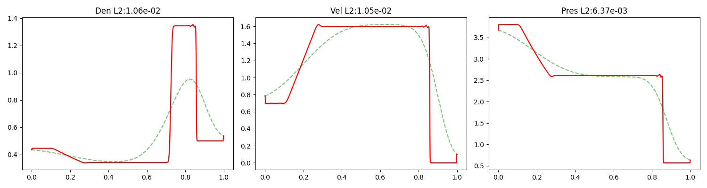

# Lax · five-point local fidelity refinement

[Project overview](../../README.md) · [Installation](../../README.md#installation) · [Choose a workflow](../../README.md#choose-a-workflow)

The primary MLP maps two coarse Euler solutions toward high-fidelity-like
density, velocity, and pressure. A separate residual-learning path predicts
a correction to LF1.

## Data contract

| Stage | Primary MLP recipe |
| --- | --- |
| LF → target | 50 / 100 → 800 points, linear alignment |
| Features | Two five-point stencils × three variables = 30 |
| Output | Density, velocity, pressure |
| Transforms | Z-score statistics rebuilt from training LF1 |
| Boundaries | Two points at each end copied from aligned LF1 |

## Run the packaged checkpoint

After [installation](../../README.md#installation) and LFS retrieval, run from
the repository root:

```bash
MPLBACKEND=Agg python problems/1d_lax/src/prediction/predict_mlp.py
```

Reads [raw training and prediction fields](data/raw/) and
[best_model_lax_final.pth](models/best_model_lax_final.pth). Writes figures to
[results/mlp](results/mlp/) and prints errors. Training fields rebuild scaling;
HF prediction fields are references for evaluation.



*Existing packaged P3.80 figure: density, velocity, and pressure. Historical
figures in the results tree are not a newly measured cross-model benchmark.*

## Choose the branch deliberately

| Path | Prediction target | Checkpoint status |
| --- | --- | --- |
| Primary MLP | Full normalized field | `best_model_lax_final.pth` supplied |
| Residual ResNet | Normalized HF − LF1 correction, added back to LF1 | `best_model_lax_resnet.pth` is not supplied; train separately |

Residual scaling uses training HF and LF1 differences. The branches have
different architectures and normalization contracts; weights are not
interchangeable. Existing [residual figures](results/resnet/) do not replace
a matching checkpoint. Compare physical cases and variables before drawing
conclusions about either branch; this guide claims no model ranking.

## Optional rebuild from CFD

These steps regenerate fields or train models and can replace named outputs.
They are not required for primary MLP inference.

The Lax workflow has a primary MLP branch and an optional residual-learning
ResNet branch. The CFD generator creates 48 files: 11 training cases and 5
prediction cases at three resolutions.

### Step 2.1: Generate and Verify CFD Data

```bash
python problems/1d_lax/src/cfd/generate_data.py
python problems/1d_lax/src/preprocessing/verify_data.py
```

- **Reads:** `problems/1d_lax/src/cfd/solver.cpp`
- **Generates:** the compiled solver under `src/cfd/bin/` and
  `train_P*_50.dat`, `train_P*_100.dat`, `train_P*_800.dat`, plus the
  corresponding `pred_P*` files under `problems/1d_lax/data/raw/`

### Step 2.2: Train and Run the Primary MLP

```bash
python problems/1d_lax/src/training/train_mlp.py
python problems/1d_lax/src/prediction/predict_mlp.py
```

- **Training reads:** synchronized training `.dat` files at 50, 100, and 800
  points; preprocessing and dual five-point stencil extraction occur in the
  training script
- **Training generates:** `problems/1d_lax/models/best_model_lax_final.pth`
- **Prediction reads:** prediction `.dat` files and the trained checkpoint
- **Prediction generates:** figures under
  `problems/1d_lax/results/mlp/`

For a one-epoch check, prefix the training command with
`NNLCI_EPOCHS=1 NNLCI_MODEL_FILENAME=smoke_lax.pth`.

### Step 2.3: Optional Residual-Learning Branch

```bash
python problems/1d_lax/src/training/train_resnet.py
python problems/1d_lax/src/prediction/predict_resnet.py
```

This branch generates/reads `models/best_model_lax_resnet.pth` and writes its
results to `problems/1d_lax/results/resnet/`.
