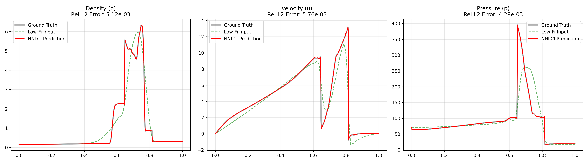

# 1D Woodward-Colella Blast Wave

Pipeline: supplied 100/200/1600-point arrays -> 800-point target construction
-> dual-fidelity three-point stencils -> MLP training -> predictions and
metrics.

The original CFD batch generator is not included in this package, so this
workflow begins with the supplied arrays.

```bash
python3 problems/1d_woodward_colella/src/run.py train --epochs 10000 --model best_model_800.pth
python3 problems/1d_woodward_colella/src/run.py predict --model best_model_800.pth
```

- Supplied arrays: `data/raw/`
- Current and legacy weights: `models/`
- Prediction arrays and figures: `results/`

## Representative Result

The figure below shows a held-out Woodward-Colella case. NNLCI reconstructs
the high-fidelity density, velocity, and pressure profiles from the
low-fidelity input, with the strongest differences concentrated near shocks
and contact features.

<p align="center">
  
</p>

Additional test-case figures are available in `results/`, and per-variable
errors are summarized in `results/test_metrics.csv`.
